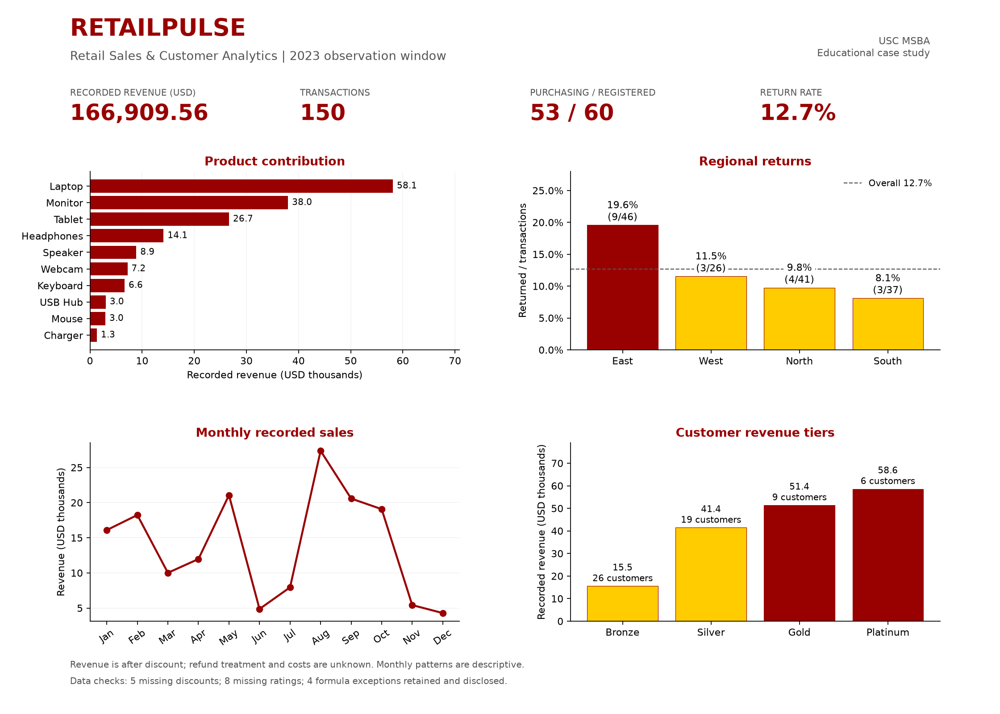

# RetailPulse | Retail Sales & Customer Analytics

**Python · Pandas · NumPy · Matplotlib · RFM segmentation · Operations analytics**

A portfolio adaptation of a USC MS Business Analytics pre-program team project,
analyzing **150 transactions, 60 registered customers, four regions and 10 products**
in an educational retail case. The 2023 observation window contains 53 purchasers.

## Project timeline

- **Summer 2026 — Original coursework:** USC MSBA pre-program team project.
  I was the primary coding/analysis contributor. Work was done in Colab
  with Google Drive inputs. No GitHub repository existed at that time.
- **October 2026 — Portfolio revision, this repository:** With Codex
  assistance, I refactored the notebook into a reusable Python module
  with CLI exports, added regression tests and dashboard reporting,
  added explicit data validation, and corrected the methods listed below.

**[One-page executive summary](outputs/executive_summary.pdf)** ·
**[Executed notebook](notebooks/report.ipynb)** ·
**[Analysis code](src/retail_analytics.py)**

## Findings

| Question | Evidence | Proposed investigation |
|---|---|---|
| What drives revenue? | Laptops contribute 34.8% of recorded revenue from 12 transactions. | Review sales, returns and costs together before judging profitability. |
| Where do returns warrant review? | East: 9/46 returns (19.6%); other regions combined: 10/104 (9.6%). | Review the nine East returns and product/payment mix before assigning causes. |
| Why is West's total lower? | 26 transactions; average value $1,101.17, close to the overall $1,112.73. | Check activity coverage, traffic and conversion before diagnosing pricing. |
| Which customers stand out? | C051 has the highest heuristic RFM score, 15; revenue rankings identify different customers. | Use both value and recent activity in a proposed CRM review. |
| What needs data follow-up? | Four formula exceptions involving unknown discounts total -$261.77 under a 0% fill. | Obtain missing discounts; retain source revenue until verified. |

Recorded revenue totals **$166,909.56**, and the overall return rate is **19/150
(12.7%)**. Revenue is after discount; refund treatment and costs are unknown.
No realized business impact is claimed.

## What the project demonstrates

(in this portfolio revision)

The original notebook already had reusable functions. This revision moved them
out of the notebook into a separate `src/` module.

- **Data preparation:** explicit dates, boolean normalization, missingness flags,
  key validation, many-to-one joins and revenue-formula checks.
- **Business analysis:** regional/product KPIs, transaction counts, discount-band
  comparisons and feedback analysis with explicit denominators.
- **Customer segmentation:** revenue tiers, signup-cohort comparisons and RFM
  scores that preserve ties and identify customers with no observed purchases.
- **Communication:** an executed narrative notebook, charts, a one-page summary
  and documented recommendations and limitations.
- **Reusable code:** an analysis module, command-line exports and regression tests.

## Data integrity decisions

- The Week 0 transaction file matches the **Week 5 External** customer master.
  The different Week 0 customer file has incompatible IDs and is excluded.
  All 150 transactions match the 60-customer master without row expansion.
- **Five missing discounts:** filled with zero for loading, flagged, and shown as a
  separate Missing discount band in comparisons.
  The fifth missing-discount record matches the 0% formula, so it is not listed
  as a formula exception. Only four records differ by more than $0.01.
- **Eight missing ratings:** kept missing; low-rating rates use observed responses.
- **Four formula exceptions:** source revenue is preserved; differences are in
  [revenue_formula_checks.csv](outputs/revenue_formula_checks.csv).
- **Nine pre-signup transactions:** flagged rather than deleted; signup may mean
  loyalty enrollment rather than first purchase.
- Customer names are replaced with ID-based labels. Analytical values and IDs are
  unchanged. [Source fingerprints](data/source_manifest.json) document the versions.

## Original vs. Revision

| Area | Original | Revision |
|---|---|---|
| Code form | Notebook functions in Colab | Separate `src/` module + CLI |
| Data validation | Basic info/merge, missing discounts filled with 0% | Explicit identifier, join cardinality, and revenue-formula checks, missing values flagged |
| Ratings | Customer-mean imputation in the discount analysis | Kept missing, observed responses only |
| RFM | `rank(method="first")` broke ties by row order | Tie-preserving scores |
| Payment test | Chi-square p = 0.00183 presented as significant | Descriptive only, not a standalone verdict |
| Reporting | Notebook charts and CSVs | Dashboard, one-page PDF, 17 CSVs, validation record, 12 regression tests on artificial fixtures |
| Privacy | Real customer names in the local notebook | ID-based labels in all public inputs |

## Run the project

Use **Python 3.12** and run from the repository root:

~~~bash
python -m venv .venv
# Activate .venv using the command for your operating system.
python -m pip install -r requirements.txt
python -m unittest discover -s tests -v
python src/main.py --data-dir data --output-dir outputs --as-of 2023-12-31
python src/build_dashboard.py
python src/build_summary.py
python scripts/execute_notebook.py
~~~

Both case CSVs are included in data/. No personal Google Drive mount is required.
The notebook can also be opened in Jupyter after installing a notebook interface.
Committed outputs let readers inspect the results directly on GitHub.

## Validation

- **12 regression tests passed**, using separately labeled artificial fixtures.
- **11 notebook code cells executed with zero errors** on the included case data.
- Revenue, transaction count, returns and signup-cohort summaries reconcile with
  the original notebook's stored output. Ratings, RFM tie treatment and missing-
  discount bands intentionally differ where methods were corrected.
- **17 CSV tables** and the KPI/data-audit JSON are exported.

See the [validation record](docs/validation.md) for the environment and checks.

## Project structure

~~~text
data/          Case inputs, ID-based names and source manifest
src/           Analysis functions, CLI, dashboard and PDF generators
notebooks/     Executed report.ipynb with inline charts
outputs/       Summary PDF, dashboard, 17 CSVs and run_summary.json
tests/         Regression tests using artificial fixtures
scripts/       Input preparation and portable notebook execution
docs/          Methodology, findings, attribution and resume wording
~~~

## Scope and attribution

This is a retrospective portfolio adaptation of team coursework. I was the
primary coding/analysis contributor of this team project. Subsequent refactoring,
testing and documentation were developed with Codex assistance.
See [contributions](docs/contributions.md) and [resume wording](docs/resume.md).

The course brief is not republished. Data is attributed to the USC MSBA pre-program
RetailPulse exercise; no independent license for course materials is asserted.

Discount comparisons are observational. One year does not establish recurring
seasonality. Low ratings and non-purchase do not establish churn. Sparse payment
groups and repeated customers limit a standalone independence-test conclusion.
See [methodology](docs/methodology.md) for definitions and decision limits.
